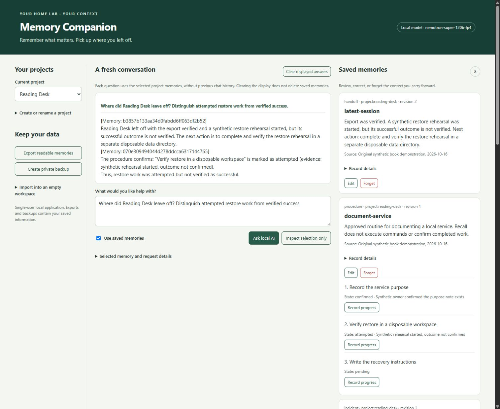

# Give Your Home Lab’s AI a Memory — Companion Code

Build a local assistant that carries selected preferences and project context into a fresh conversation. Inspect what it remembers, see what was supplied to the model, and correct or forget records deliberately.

Companion code for the forthcoming book by Saurabh Chase. The book is in production. This repository contains a working development application; the first-edition code tag and verified retailer link will be added when available. Original companion code and synthetic fixtures are MIT licensed. The separately published manuscript and artwork are not part of that grant.



This screenshot comes from the running application, not a mockup. It contains original synthetic data and an actual response from a locally served model.

## Working application

- Local chat interface and visible memory panel, with no cloud fallback or external browser assets.
- Preferences, decisions, handoffs, incidents, and procedures.
- Project scopes, global preferences, stable project identities, and earlier-name aliases.
- Version-checked corrections, expiry, forgetting, and content-free audit events.
- AI-suggested preferences that remain proposals until reviewed.
- Inspectable selected context and with-memory/without-memory requests.
- Procedure progress with evidence for confirmed steps; no command execution.
- Readable JSON import/export, consistent SQLite backup, and restore into a new workspace.

Model inference comes from a separately installed local engine with downloaded weights. No cloud subscription or cloud memory service is required. A loopback URL alone does not prove what a proxy does upstream; see the [local-only guide](docs/local-only.md).

From the repository root on Windows, try the synthetic workspace:

```powershell
py -3.11 examples/seed_demo.py --data data/demo.sqlite
py -3.11 -m memory_companion --data data/demo.sqlite doctor
py -3.11 -m memory_companion --data data/demo.sqlite serve
```

Open **http://127.0.0.1:8765/** and select **Reading Desk**. Memory management and **Inspect selection only** work without inference. Configure the exact downloaded model with `MEMORY_MODEL` before asking for generated answers. The default adapter is local Ollama at port 11434; a compatible loopback adapter is also available. Read the [setup and recovery guide](docs/setup.md) for model configuration, export/import, backups, and troubleshooting.

## Code and exercises

`examples/01_first_memory.py` is a storage-only feasibility example. It uses Python's standard-library SQLite interface to save, read, replace, and forget a synthetic scoped preference across process restarts. It does not call a model or implement the complete companion.

The [acceptance scenario pack](fixtures/acceptance-scenarios.json) specifies fourteen workflow checks. Five blank [memory worksheets](templates/memory-worksheets.json) support preferences, decisions, handoffs, incidents, and procedures. See the [scenario guide](docs/acceptance-scenarios.md) for their scope and evidence requirements. Specifications are separate from observed test results.

Requirements: Python 3.11 or later. No third-party packages. From this directory:

```powershell
py -3.11 examples/01_first_memory.py --db data/first.sqlite save --scope project:reading-desk --key shell --value PowerShell
py -3.11 examples/01_first_memory.py --db data/first.sqlite get --scope project:reading-desk --key shell
py -3.11 -m unittest discover -s tests -v
```

Keep `data/first.sqlite` separate from the full application's `data/demo.sqlite`: the teaching example deliberately uses a smaller, incompatible schema. Use `python` instead of the Windows launcher only when it selects a compatible interpreter. Other platforms have not yet been directly verified. Saved demo data stays under the ignored data/ directory.

The main source is in `memory_companion/`: `store.py` owns lifecycle and retrieval; `model.py` owns loopback adapters and prompt assembly; `server.py` exposes bounded local operations; `static/` contains the actual UI shown above. `examples/seed_demo.py` creates two fictional projects supporting the four cumulative book builds. `examples/evaluate_local.py` collects actual local-model outputs separately from automated tests with a model double.

Run all eighteen disposable chapter checkpoints with `py -3.11 examples/chapter_lab.py --all`, or replace `--all` with one chapter number. These assert specific storage and application properties without calling a model. `examples/memory_agent.py` adds an optional local tool-calling example limited to scoped recall, with no memory writes or shell execution. `examples/evaluate_cpu.py` is a separate optional CPU experiment with pinned Qwen3-0.6B weights; it requires extra libraries and preserves actual outputs, including failures. See [evaluation examples](docs/evaluation.md).

Tests using a model double prove integration behavior, not model answer quality. The [version matrix](docs/version-matrix.md) identifies direct verification and pending engine/platform coverage. The large development checkpoint is not a minimum reader hardware recommendation. The immutable first-edition tag is frozen only after release checks.

## Data boundary

Do not commit user memories, databases, exports, backups, credentials, private logs, model weights, or book prose. Examples use original synthetic values. Forget in the storage example means logical removal from lookup; no physical-media erasure guarantee is made.

The first edition will cite an immutable code release with the tested versions and chapter map. Development on the default branch can change. The published-book link will be added after a verified public listing exists. No retailer URL is available yet.

See [LICENSE](LICENSE), [SECURITY.md](SECURITY.md), [third-party notices](THIRD_PARTY_NOTICES.md), and [contribution guidance](CONTRIBUTING.md). Installed model weights and runtimes retain their own licenses.
